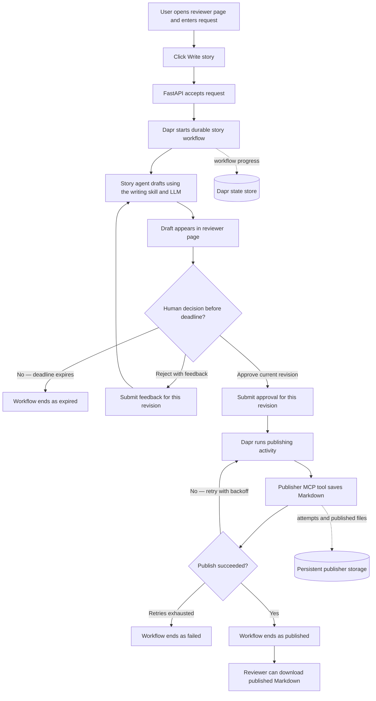

# Story agent: run and demonstrate Steps 1, 2 and 3

Every command below is typed in the **VS Code terminal (PowerShell)**, opened in this
folder (the one that contains `run.cmd`). Type them exactly as shown.

## 1. Setup (once, about 5 minutes)

```powershell
.\run setup
```

It installs Python (if missing), all packages, and the Dapr CLI and runtime, then asks
for your **OpenAI API key** once. Paste it and press Enter (it stays hidden). It creates
the `.env` file with your key in `step1`, `step2` and `step3`.

It ends with **"Setup complete"**. If it says to close and reopen VS Code, do that and
run `.\run setup` again.

## 2. Step 1: deep agent, story, human approval

```powershell
.\run step1-verify
```

Expect: a story printed, then a revised story, and **ALL CHECKS PASSED** (13 checks).

```powershell
.\run step1-demo
```

The browser opens. Click **Write story**, type feedback and click **Reject and revise**,
then **Approve and publish**. The story is saved in `step1\published`.

## 3. Step 2: MCP tool that throws an exception

```powershell
.\run step2-verify
```

Expect: **ALL CHECKS PASSED** (18 checks), including "After approval, the MCP tool's
RuntimeError stops the run".

```powershell
.\run step2-demo
```

Two windows open (MCP server, app) and the browser. Click **Write story**, then
**Approve and publish**. The page says **Publishing failed after approval**, and the
"Step 2 MCP server" window shows `attempt 1 of 8: FAIL`. Nothing retries.

## 4. Step 3: Dapr retries and durable approval

```powershell
.\run step3-demo
```

Windows open for Dapr placement, Dapr scheduler, the MCP server and the app, then the
browser. Click **Write story**, then **Approve and publish**. In the "Step 3 MCP server"
window, attempts 1 to 7 fail with growing gaps and attempt 8 publishes; after about
40 seconds the page says **Published**.

With Step 3 still running:

```powershell
.\run step3-verify
```

Expect: **ALL CHECKS PASSED** (12 checks): revision, publish on attempt 8, and a
10-second approval window that expires.

```powershell
.\run step3-restart-test
```

This leaves a story waiting for approval, **stops the app**, starts it again, then
approves the same story. Expect: "After the restart, the story is still awaiting
approval" and **ALL CHECKS PASSED**.

### Step 3: end-to-end workflow

The reviewer page is the human-in-the-loop gate: a story is not published until
the reviewer approves the current draft. Rejecting with feedback sends the
workflow back for a revised draft. The approval wait has a deadline; if it
expires, the workflow ends without publishing.



The browser refreshes workflow status and keeps a local list of recent workflows
and a browser-observed timeline. Dapr persists workflow progress and the approval
deadline, so an app restart does not lose a pending review. In the Kind
deployment, workflow state is stored in Redis and publisher files are on
persistent storage; local Dapr uses the configured local state store.

## 5. Step 3 on a Kind cluster (optional, needs Docker)

```powershell
.\run kind-tools
```

Restart Windows, open **Docker Desktop** and wait until it says it is running. Then:

```powershell
.\run step3-kind
kubectl port-forward svc/story-agent 8000:8000
```

Leave the port-forward running, open a second terminal in this folder and run
`.\run step3-verify`.

### No Docker on the laptop? Run Kind in GitHub Actions

Push this repo to GitHub, add the repository secret `OPENAI_API_KEY`
(Settings > Secrets and variables > Actions), then run the **step3-kind** workflow
(Actions tab > step3-kind > Run workflow). It creates a Kind cluster, installs Dapr, deploys
Redis + publisher + app, runs deterministic and API-level checks, then tests the browser reviewer
journey, concurrent decisions, and recovery scenarios. Download the `step3-kind-reports`
artifact for the verification reports and published Markdown.

CLI equivalent: `gh workflow run step3-kind`, then `gh run watch`, then
`gh run download <run-id> -n step3-kind-reports` (save as `step3/verify_output_step3_kind_*.txt`).
Verified green on GitHub Actions: [run 41216975350](https://github.com/Ayush-Deloitte2003/story-agent/actions/runs/41216975350)
passed the browser journey and recovery tests. `step3/requirements.txt` pins `mcp<2` and
`litellm==1.105.0` (newer releases break the image: `FastMCP` removed in mcp 2.x, litellm 1.106 needs mcp 2.x).

## Stop everything

```powershell
.\run stop
```

Run this before switching from one step's demo to another if a window is still open
(the demo commands also stop the previous step automatically).

## If something goes wrong

| Message | Fix |
| --- | --- |
| `.\run` is not recognised | Make sure the terminal is in this folder: `cd` into the folder that contains `run.cmd` |
| "Run '.\run setup' first." | Run `.\run setup` |
| Authentication error from OpenAI | Delete the `.env` file in this folder and run `.\run setup` again to re-enter the key |
| A window shows an error | Send a screenshot of that window |

The folders `step1`, `step2` and `step3` hold the project as it was at the end of
each step; their own READMEs explain the code.
