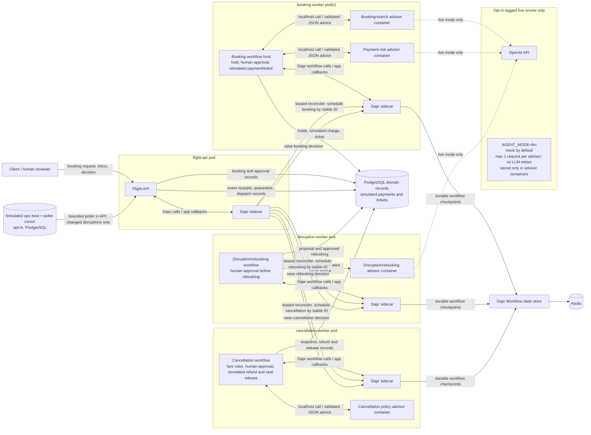

# Step 4: durable flight booking with Dapr

This is a separate, simulated flight-booking example. It does not contact an
airline or payment provider and never accepts card data. The seeded mock
inventory is `SA101`, `SA102`, and `SA201`; payments are ledger records only.
The four advisor roles can use bounded real LLM calls only in the explicit
opt-in smoke workflow; all routine CI and Kubernetes deployments use mock
advisors by default.

## Architecture

- `flight-api` accepts idempotent booking and cancellation requests, lists the
  approval inbox, records human decisions, and publishes disruption CloudEvents.
- The independently scalable `booking-worker` runs the durable seat-hold,
  approval, simulated payment, ticket, timeout, and compensation workflow. Its
  literal `booking-advisor` sidecar provides read-only search/policy guidance,
  and `payment-advisor` provides simulated payment-risk guidance. Neither can
  choose the booking, hold a seat, charge, refund, or ticket.
- `disruption-worker` is scheduled by the API dispatcher for each accepted `flight-disruption` event and runs a separate
  durable rebooking workflow. Its literal `flight-advisor` container provides
  read-only disruption/rebooking recommendations; only the workflow can reserve
  an alternative or update a ticket, and only after human approval.
- `cancellation-worker` (a third, separate Deployment) runs the durable
  `flight_cancellation_workflow`. Its literal `cancellation-advisor` sidecar (the
  fourth advisor) proposes a refund eligibility, amount and fare rule. It has no
  authority to refund, cancel or approve.
- PostgreSQL stores domain records, holds, approvals, simulated payments, and
  tickets. Dapr Workflow uses its supported Redis state store. Event receipts,
  quarantined events and dispatch records are also in PostgreSQL.



## API contracts

Create a booking with a caller-provided idempotency key:

```http
POST /bookings
Idempotency-Key: demo-booking-001
Content-Type: application/json

{"flight_id":"SA101","seat":"1A","passenger_name":"Demo Passenger","hold_seconds":300}
```

Retry with the same key and payload to get the same booking. Reusing the key
with different input returns `409`. Query it at `GET /bookings/{booking_id}`.
The booking workflow holds the selected mock seat until approval or expiry.

Acceptance is durable: the booking row and a dispatch record are committed in
one PostgreSQL transaction, then the API returns `202` with a body like
`{"booking_id":"booking-…","workflow_id":"booking-…","status":"scheduled"}`
(queued, not necessarily running; poll `GET /bookings/{booking_id}`, which
reports `QUEUED` until the workflow starts). If Dapr
or a worker is temporarily down afterwards, a leased reconciler in the API
(`FOR UPDATE SKIP LOCKED`, 30 s lease, exponential backoff capped at 30 s)
keeps retrying; workers schedule by stable workflow ID. Errors before the
commit (validation, idempotency conflict) remain errors.

Delivery guarantee: **at-least-once delivery with idempotent effects** (not
exactly-once). When a worker confirms scheduling, or reports that the workflow
already exists, the dispatcher writes a durable `scheduled_at` marker on the
dispatch record. The reconciler checks that marker, not Dapr workflow history,
before invoking a worker, so purging Dapr history after the marker exists
cannot cause rescheduling. A crash between Dapr scheduling and the marker write
causes one redelivery with the same stable workflow ID, which the worker treats
as already existing. A replica whose lease was taken over cannot write the
marker or complete the record. The column is added with
`ADD COLUMN IF NOT EXISTS` and backfilled for already-dispatched rows. Residual
gap: if history is purged in the window between Dapr scheduling and the marker
write, and no booking or approval row exists yet, a redelivery could start the
workflow again.

`GET /inbox` lists pending human decisions; `GET /inbox/{workflow_id}` returns
the current state of one approval, including completed rebookings. Approve or reject with
`POST /inbox/{workflow_id}/decision` and `{"decision":"approve"}` or
`{"decision":"reject"}`. For a disruption, approve with a proposed
`flight_id`, e.g. `{"decision":"approve","flight_id":"SA102"}`. The API rejects
an alternative that was not proposed.

Publish a disruption with `POST /disruptions`:

```json
{"id":"airline-event-17","source":"mock-ops","booking_id":"booking-id","flight_id":"SA101"}
```

The event registry (`app/events.py`) maps `com.example.flight.disrupted`
(the default type; flat or CloudEvent-style `data` body) to its schema and
worker. A valid event is recorded in `event_receipts` with a dispatch record
and returns `202` `accepted`; the same `(source, id)` and payload returns
`duplicate`, a changed payload returns `409`. Unknown types or invalid data
return `202` `quarantined` and are stored in `quarantined_events` with the
reason instead of being dropped. Workflow IDs derive from source and event ID,
so re-delivery never starts another rebooking workflow. Events carry no
passenger or payment data. Approvals, simulated payments and flights are
unchanged; there is no dashboard or quarantine replay.

### Simulated operations feed and poller

Disruptions can also arrive without a manual call. A bounded, opt-in poller
(`app/feed_poller.py`) reads a simulated PostgreSQL feed table
(`ops_feed_events`: stable `source_event_id`, JSON payload) and creates
disruption events. It never connects to an airline or any external service, and
it only creates events: workflows, human approval, simulated payments and
simulated flights stay authoritative, and no event can approve a rebooking.

- **Off by default.** `OPS_FEED_POLL_ENABLED=true` starts it as a task in the
  existing API process (no new service). Tunables: `OPS_FEED_POLL_INTERVAL_SECONDS`
  (5), `OPS_FEED_BATCH_SIZE` (20 feed rows per pass),
  `OPS_FEED_MAX_EVENTS_PER_PASS` (200 disruption events per pass),
  `OPS_FEED_DELAY_THRESHOLD_MINUTES` (60). The checked-in manifests do not set
  any of these; the `step4-kind` workflow enables them with `kubectl set env`.
- **Seeding.** `POST /simulation/ops-feed` with
  `{"source_event_id":"s1","flight_id":"SA101","status":"cancelled"}` inserts a
  row (`on_time`, `delayed` with `delay_minutes`, or `cancelled`). It returns 404
  unless `OPS_FEED_SIMULATION=true` and is idempotent on `source_event_id`.
- **What counts as a change.** A row emits only when it is disruptive
  (`cancelled`, or `delayed` with `delay_minutes` at or above the threshold) and
  its `(status, disruptive)` differs from the flight's stored status. Repeats are
  suppressed, including a different delay inside `delayed`. Moving to `on_time` or
  a minor delay updates the stored status without emitting, so a later disruption
  is a new event.
- **Routing.** One event per confirmed booking ticketed on the flight (id
  `<source_event_id>:<booking_id>`, source `ops-feed-simulator`) goes through the
  same registry, `event_receipts` and `dispatch_records` path as
  `POST /disruptions`, so workflow IDs and the leased reconciler are unchanged.
- **Cursor.** `poller_cursors` stores the last fully processed feed `seq`. One
  transaction per pass locks the cursor row (`FOR UPDATE SKIP LOCKED`, so other
  replicas skip that tick) and writes receipts, dispatch records, quarantines,
  flight status and the cursor together. A crash before commit replays the pass;
  re-emitting an event hits the existing receipt key and creates no second
  workflow. Rows are read only below the snapshot's `xmin`, so a lower `seq` that
  commits late is not skipped (requires PostgreSQL 13+; the manifests and CI use
  16). If one row fans out past the per-pass cap, the cursor records a partial
  position (`partial_seq`, `partial_booking_id`) and the flight status is stored
  only when the whole row is done.
- **Bad rows.** Malformed rows, unknown statuses and unknown flights are written
  to `quarantined_events` in the same transaction and the cursor moves past them.
- **Observability.** One log line per pass with a poll ID and counts only, plus
  in-process counters at `GET /ops-feed/status` (cursor and counters, no
  payloads).

Guarantee: at-least-once delivery with idempotent effects, not exactly-once.
Limitations: a booking ticketed after a flight's status change is not
re-evaluated; a long-open transaction elsewhere in the database delays feed
reads until it ends; counters are per process.

## Cancellations and simulated refunds

`POST /cancellations` with an `Idempotency-Key` header and
`{"booking_id":"booking-…"}` uses the same durable path as bookings: the
cancellation row and a dispatch record commit together, the API returns `202`
with `cancellation_id`, `workflow_id`, `booking_id` and `status: scheduled`, and
the leased reconciler schedules `flight_cancellation_workflow` by stable ID
(`cancellation-…`) on `cancellation-worker`. The same key and payload return the
same cancellation, a changed payload returns `409`, an unknown booking `404`, and
a booking that is not `confirmed` (including already cancelled) or already has an
active cancellation `409`. Status is visible through `GET /inbox`,
`GET /inbox/{id}` and `GET /bookings/{id}`.

- **Deterministic authority.** The refund comes only from fare rules in the mock
  catalog, applied to values snapshotted when the request was accepted
  (`requested_at`, the amount paid, the departure time): 100% at 72h or more
  before departure, 50% from 24h up to 72h, 0% under 24h. A later price or
  schedule change cannot alter the amount; recomputing is used only to detect a
  stale ticket (a different flight or seat than the snapshot).
- **Advisor.** The cancellation advisor's JSON (eligibility, proposed refund,
  fare rule, rationale) is validated against the deterministic result. Any
  mismatch or advisor failure falls back to the deterministic amount and records
  `advice_note` on the cancellation and proposal.
- **Human approval bound to the request.** Approving needs `request_hash` and
  `refund_cents` from the proposal; without them the API returns `422`, and a
  mismatch returns `409` (the workflow also re-checks and ends `stale`). Rejection
  needs neither. Booking and rebooking approvals are unchanged and ignore these
  fields.
- **Effects.** After approval the simulated refund (one issued refund per
  booking, keyed by cancellation) and seat release are idempotent and retried.
  The booking becomes `cancelled`; the ticket row is retained.
- **Failure handling.** If the refund step fails, the cancellation ends
  `refund_failed` and the booking stays confirmed. If seat release fails after the
  refund, the refund is reversed and it ends `failed`. Rejection ends `rejected`
  and expiry `expired`, with the booking confirmed.
- **One active cancellation.** Only `scheduled` and `awaiting_approval` count as
  active. After any terminal status (`rejected`, `expired`, `stale`,
  `not_confirmed`, `refund_failed`, `failed`) a new request with a new
  idempotency key is allowed while the booking is confirmed, so a booking is never
  blocked forever.
- **Races.** Cancellation and rebooking serialize on the booking row. If the
  cancellation finishes first, a rebooking fails with "only confirmed bookings".
  If a rebooking finishes first, the cancellation ends `stale`. A rebooking is
  refused while a cancellation is active.

Guarantee: at-least-once delivery with idempotent effects, not exactly-once.
Limitations: the ticket is retained after cancellation (booking status is
authoritative); refunds are simulated ledger records only.

## Run and verify

From the repository root, enter `step4\`, then use Python 3.12+:

```powershell
python -m pip install -r requirements.txt
python -m unittest discover -s tests -v
```

The GitHub Actions workflow `step4-kind` builds the image, deploys
PostgreSQL, Redis, Dapr, and the application deployments (API plus booking,
disruption and cancellation workers) to Kind, then
runs deterministic API checks. It covers duplicate idempotency keys, seat
contention, approval, hold expiry, injected payment and ticketing failures,
compensation/refund, workflow recovery after a worker pod replacement, duplicate
disruption events, cancellation approval, rejection, expiry and duplicate
requests (mock advisor), the opt-in operations-feed poller (seeded cancelled-flight row,
bad-row quarantine, approval still required), and human-approved rebooking. Failure injection is enabled
only in this disposable Kind manifest and is disabled by default elsewhere.
The Kubernetes Postgres password is a local-test placeholder; do not reuse it.

## Optional live LLM smoke

The four sidecars implement booking/search, payment-risk,
disruption/rebooking and cancellation-policy advisor roles. The tagged live
smoke below exercises only the original three; the cancellation advisor is
validated with mock advisors only. Their responses are bounded JSON and are
validated again by the durable workflows against the mock catalog. They are
advisory only: workflow code and human decisions retain all authority. The
payment gateway remains simulated, and prompts contain no passenger or card
data.

The `mock-tests` job explicitly uses `AGENT_MODE=mock` and does not receive
`OPENAI_API_KEY`. For the single reviewed live smoke, configure the repository
Actions secret `OPENAI_API_KEY`, push the reviewed feature commit, then create
and push a unique tag matching
`step4-live-llm-smoke-*` on that commit. For example:

```powershell
git tag step4-live-llm-smoke-reviewed-run-1
git push origin step4-live-llm-smoke-reviewed-run-1
```

The tag-triggered job creates a fresh Kind cluster, injects the secret only into
the three advisor sidecars, runs one booking through booking/search and
payment-risk approval, then one disruption through rebooking approval. The
booking worker is scaled to one replica and each advisor sidecar has
`LLM_REQUEST_LIMIT=1`; the three activities have no retry policy. This bounds
the intended run to three provider requests total (below the hard maximum of
five). The verifier checks the booking workflow's `awaiting_approval` stage,
the pending rebooking proposal, human approval, and completed rebooking.
Ordinary branch pushes run only mock tests, and rerunning a completed workflow
attempt cannot repeat live calls. Provider output and secret material are not
printed.
Do not create or push the tag until the workflow and diff have been reviewed.

No local Docker/Kind validation is claimed. The Actions workflow is the
cluster-validation path. There is intentionally no payment-provider or airline
integration, no real booking/payment effect, and no performance/load test.
