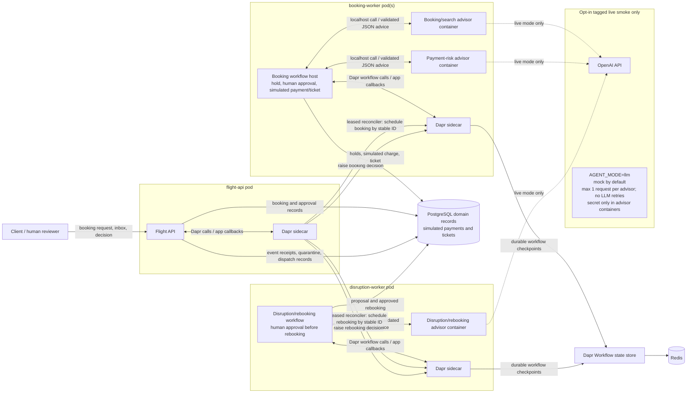

# Step 4: durable flight booking with Dapr

This is a separate, simulated flight-booking example. It does not contact an
airline or payment provider and never accepts card data. The seeded mock
inventory is `SA101`, `SA102`, and `SA201`; payments are ledger records only.
The three advisor roles can use bounded real LLM calls only in the explicit
opt-in smoke workflow; all routine CI and Kubernetes deployments use mock
advisors by default.

## Architecture

- `flight-api` accepts idempotent booking requests, lists the approval inbox,
  records human decisions, and publishes disruption CloudEvents.
- The independently scalable `booking-worker` runs the durable seat-hold,
  approval, simulated payment, ticket, timeout, and compensation workflow. Its
  literal `booking-advisor` sidecar provides read-only search/policy guidance,
  and `payment-advisor` provides simulated payment-risk guidance. Neither can
  choose the booking, hold a seat, charge, refund, or ticket.
- `disruption-worker` is scheduled by the API dispatcher for each accepted `flight-disruption` event and runs a separate
  durable rebooking workflow. Its literal `flight-advisor` container provides
  read-only disruption/rebooking recommendations; only the workflow can reserve
  an alternative or update a ticket, and only after human approval.
- PostgreSQL stores domain records, holds, approvals, simulated payments, and
  tickets. Dapr Workflow uses its supported Redis state store. Event receipts,
  quarantined events and dispatch records are also in PostgreSQL.



## API contracts

Create a booking with a caller-provided idempotency key:

```http
POST /bookings
Idempotency-Key: demo-booking-001
Content-Type: application/json

{"flight_id":"SA101","seat":"1A","passenger_name":"Demo Passenger","hold_seconds":300}
```

Retry with the same key and payload to get the same booking. Reusing the key
with different input returns `409`. Query it at `GET /bookings/{booking_id}`.
The booking workflow holds the selected mock seat until approval or expiry.

Acceptance is durable: the booking row and a dispatch record are committed in
one PostgreSQL transaction, then the API returns `202` with a body like
`{"booking_id":"booking-…","workflow_id":"booking-…","status":"scheduled"}`
(queued, not necessarily running; poll `GET /bookings/{booking_id}`, which
reports `QUEUED` until the workflow starts). If Dapr
or a worker is temporarily down afterwards, a leased reconciler in the API
(`FOR UPDATE SKIP LOCKED`, 30 s lease, exponential backoff capped at 30 s)
keeps retrying; workers schedule by stable workflow ID. Errors before the
commit (validation, idempotency conflict) remain errors.

Delivery guarantee: **at-least-once delivery with idempotent effects** (not
exactly-once). When a worker confirms scheduling, or reports that the workflow
already exists, the dispatcher writes a durable `scheduled_at` marker on the
dispatch record. The reconciler checks that marker, not Dapr workflow history,
before invoking a worker, so purging Dapr history after the marker exists
cannot cause rescheduling. A crash between Dapr scheduling and the marker write
causes one redelivery with the same stable workflow ID, which the worker treats
as already existing. A replica whose lease was taken over cannot write the
marker or complete the record. The column is added with
`ADD COLUMN IF NOT EXISTS` and backfilled for already-dispatched rows. Residual
gap: if history is purged in the window between Dapr scheduling and the marker
write, and no booking or approval row exists yet, a redelivery could start the
workflow again.

`GET /inbox` lists pending human decisions; `GET /inbox/{workflow_id}` returns
the current state of one approval, including completed rebookings. Approve or reject with
`POST /inbox/{workflow_id}/decision` and `{"decision":"approve"}` or
`{"decision":"reject"}`. For a disruption, approve with a proposed
`flight_id`, e.g. `{"decision":"approve","flight_id":"SA102"}`. The API rejects
an alternative that was not proposed.

Publish a disruption with `POST /disruptions`:

```json
{"id":"airline-event-17","source":"mock-ops","booking_id":"booking-id","flight_id":"SA101"}
```

The event registry (`app/events.py`) maps `com.example.flight.disrupted`
(the default type; flat or CloudEvent-style `data` body) to its schema and
worker. A valid event is recorded in `event_receipts` with a dispatch record
and returns `202` `accepted`; the same `(source, id)` and payload returns
`duplicate`, a changed payload returns `409`. Unknown types or invalid data
return `202` `quarantined` and are stored in `quarantined_events` with the
reason instead of being dropped. Workflow IDs derive from source and event ID,
so re-delivery never starts another rebooking workflow. Events carry no
passenger or payment data. Approvals, simulated payments and flights are
unchanged; there is no poller or dashboard.

## Run and verify

From the repository root, enter `step4\`, then use Python 3.12+:

```powershell
python -m pip install -r requirements.txt
python -m unittest discover -s tests -v
```

The GitHub Actions workflow `step4-kind` builds the image, deploys
PostgreSQL, Redis, Dapr, and the three application deployments to Kind, then
runs deterministic API checks. It covers duplicate idempotency keys, seat
contention, approval, hold expiry, injected payment and ticketing failures,
compensation/refund, workflow recovery after a worker pod replacement, duplicate
disruption events, and human-approved rebooking. Failure injection is enabled
only in this disposable Kind manifest and is disabled by default elsewhere.
The Kubernetes Postgres password is a local-test placeholder; do not reuse it.

## Optional live LLM smoke

The three sidecars implement booking/search, payment-risk, and
disruption/rebooking advisor roles. Their responses are bounded JSON and are
validated again by the durable workflows against the mock catalog. They are
advisory only: workflow code and human decisions retain all authority. The
payment gateway remains simulated, and prompts contain no passenger or card
data.

The `mock-tests` job explicitly uses `AGENT_MODE=mock` and does not receive
`OPENAI_API_KEY`. For the single reviewed live smoke, configure the repository
Actions secret `OPENAI_API_KEY`, push the reviewed feature commit, then create
and push a unique tag matching
`step4-live-llm-smoke-*` on that commit. For example:

```powershell
git tag step4-live-llm-smoke-reviewed-run-1
git push origin step4-live-llm-smoke-reviewed-run-1
```

The tag-triggered job creates a fresh Kind cluster, injects the secret only into
the three advisor sidecars, runs one booking through booking/search and
payment-risk approval, then one disruption through rebooking approval. The
booking worker is scaled to one replica and each advisor sidecar has
`LLM_REQUEST_LIMIT=1`; the three activities have no retry policy. This bounds
the intended run to three provider requests total (below the hard maximum of
five). The verifier checks the booking workflow's `awaiting_approval` stage,
the pending rebooking proposal, human approval, and completed rebooking.
Ordinary branch pushes run only mock tests, and rerunning a completed workflow
attempt cannot repeat live calls. Provider output and secret material are not
printed.
Do not create or push the tag until the workflow and diff have been reviewed.

No local Docker/Kind validation is claimed. The Actions workflow is the
cluster-validation path. There is intentionally no payment-provider or airline
integration, no real booking/payment effect, and no performance/load test.
