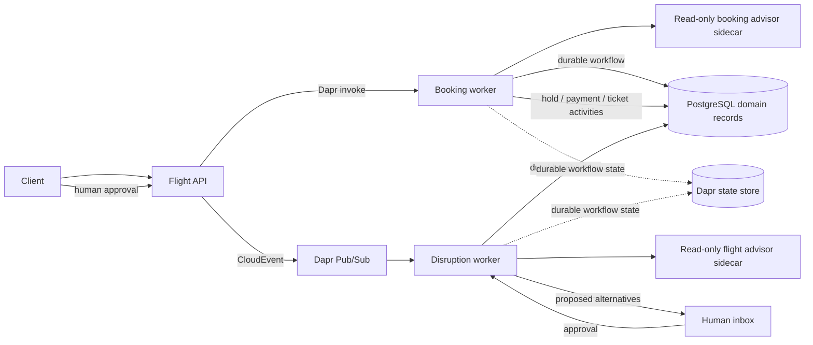

# Step 4: durable flight booking with Dapr

This is a separate, simulated flight-booking example. It does not contact an
airline or payment provider and never accepts card data. The seeded mock
inventory is `SA101`, `SA102`, and `SA201`; payments are ledger records only.
Model calls are not used.

## Architecture

- `flight-api` accepts idempotent booking requests, lists the approval inbox,
  records human decisions, and publishes disruption CloudEvents.
- The independently scalable `booking-worker` runs the durable seat-hold,
  approval, simulated payment, ticket, timeout, and compensation workflow. Its
  literal `booking-advisor` sidecar returns mock catalog facts and same-route
  alternatives; it cannot choose the booking, hold a seat, charge, or ticket.
- `disruption-worker` consumes `flight-disruption` events and runs a separate
  durable rebooking workflow. Its literal `flight-advisor` container is a
  deterministic, read-only recommendation process; only the workflow can
  reserve an alternative or update a ticket, and only after human approval.
- PostgreSQL stores domain records, holds, approvals, simulated payments, and
  tickets. Dapr Workflow uses its supported Redis state store; Redis Pub/Sub
  delivers disruption CloudEvents at least once.



## API contracts

Create a booking with a caller-provided idempotency key:

```http
POST /bookings
Idempotency-Key: demo-booking-001
Content-Type: application/json

{"flight_id":"SA101","seat":"1A","passenger_name":"Demo Passenger","hold_seconds":300}
```

Retry with the same key and payload to get the same booking. Reusing the key
with different input returns `409`. Query it at `GET /bookings/{booking_id}`.
The booking workflow holds the selected mock seat until approval or expiry.

`GET /inbox` lists pending human decisions. Approve or reject with
`POST /inbox/{workflow_id}/decision` and `{"decision":"approve"}` or
`{"decision":"reject"}`. For a disruption, approve with a proposed
`flight_id`, e.g. `{"decision":"approve","flight_id":"SA102"}`. The API rejects
an alternative that was not proposed.

Publish a disruption with `POST /disruptions`:

```json
{"id":"airline-event-17","source":"mock-ops","booking_id":"booking-id","flight_id":"SA101"}
```

The source and event ID determine a stable workflow ID. Re-delivery does not
start another rebooking workflow. The CloudEvent payload contains no passenger
or payment data.

## Run and verify

From the repository root, enter `step4\`, then use Python 3.12+:

```powershell
python -m pip install -r requirements.txt
python -m unittest discover -s tests -v
```

The manual GitHub Actions workflow `step4-kind` builds the image, deploys
PostgreSQL, Redis, Dapr, and the three application deployments to Kind, then
runs deterministic API checks. It covers duplicate idempotency keys, seat
contention, approval, hold expiry, injected payment and ticketing failures,
compensation/refund, workflow recovery after a worker pod replacement, duplicate
disruption events, and human-approved rebooking. Failure injection is enabled
only in this disposable Kind manifest and is disabled by default elsewhere.
The Kubernetes Postgres password is a local-test placeholder; do not reuse it.

No local Docker/Kind validation is claimed. The Actions workflow is the
cluster-validation path. There is intentionally no payment gateway, airline
integration, model provider, or performance/load test.
